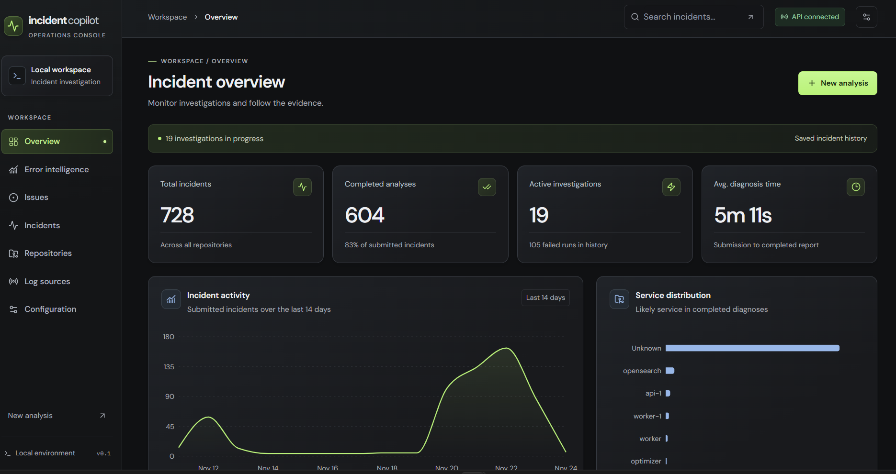
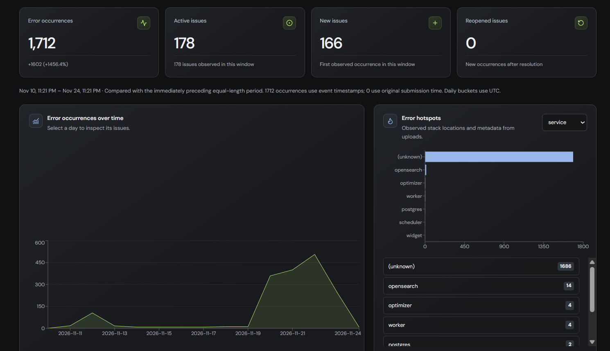
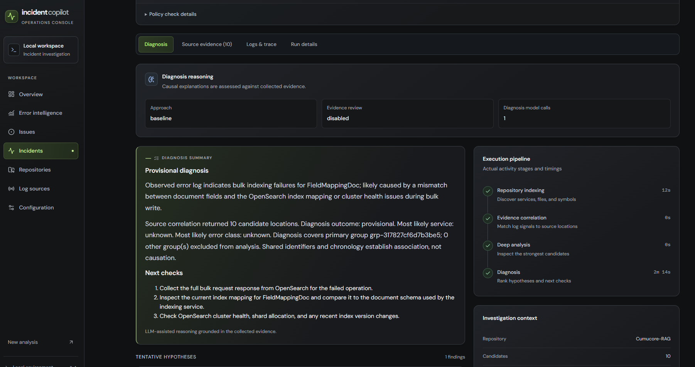
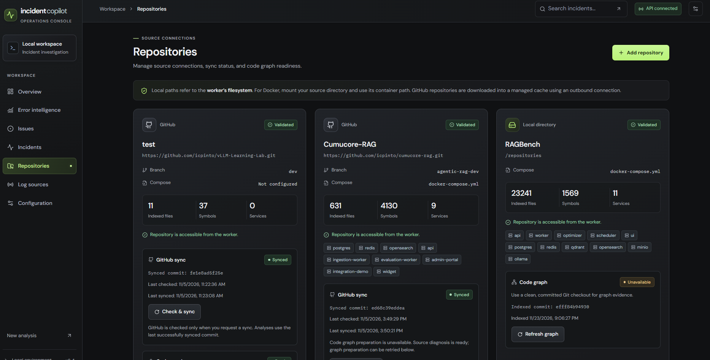
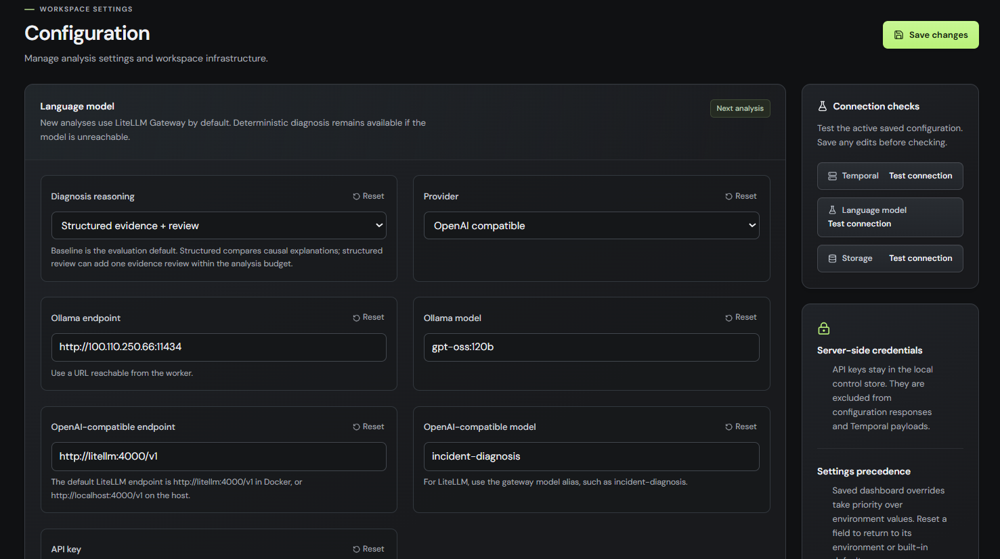

# Incident Copilot

A diagnosis-first incident copilot for containerized monorepos.

Read the [architecture handbook](docs/architecture.md) for the complete implemented
design: Temporal stages, both LangGraph flows, fixed and ReAct-style patterns,
evidence tools, memory/context engineering, NeMo Guardrails, LiteLLM, and Langfuse.

Incident Copilot turns supplied error logs, repository source, and optional runtime
observations into cited hypotheses and practical next checks. Responders perform
checks and mitigations manually; the application does not patch code, execute
mitigations, or deploy changes.

## Implementation overview

The **React dashboard** is served by **FastAPI**. A shared **SQLite control store**
persists repository profiles, incident inputs and results, immutable settings revisions,
and issue triage history. Dashboard submissions are saved before dispatch to
**Temporal**, which schedules the Python worker and handles activity retries and
recovery. Progress and cancellation remain available after leaving the dashboard;
an unavailable Temporal service leaves submissions queued for automatic dispatch.

Each dashboard investigation runs through four stages:

| Stage | Implemented behavior |
| --- | --- |
| Indexing | Validate worker access, map Compose services, and build an isolated SQLite source index. The optional `parsing` extra enables Tree-sitter with parser fallbacks. |
| Correlating | Parse errors and stack frames, build an incident timeline, select the primary trace/request group, and deterministically rank candidate services, files, and symbols. |
| Analyzing | Inspect the strongest candidates with deeper language-aware analysis and collect available static code graph context. |
| Reasoning | Run the selected LangGraph flow, validate its output, and save the diagnosis with JSON and Markdown report artifacts. |

**Temporal controls durable execution; LangGraph controls diagnosis reasoning.** The
default fixed flow reasons over curated evidence. Optional
[iterative investigation](docs/agentic-investigation.md) lets the model request
additional read-only source and, when configured, runtime evidence within enforced
round, request, and time budgets. Checkpoints preserve completed investigation work
and consumed budgets across worker retries. Model failures retain usable prior
assessments where available, or fall back to deterministic diagnosis; reports identify
the actual engine and limitations. Optional
[structured reasoning and selective review](docs/structured-reasoning.md) apply to both
flows; baseline reasoning remains the default.

The implementation also includes:

- **Repository context:** local directories and manually synced GitHub profiles,
  worker-side validation, and retained source revisions. Managed
  [GitNexus code graphs](docs/code-graph.md) are enabled by default and provide bounded
  static callers and callees when a matching graph is available.
- **Collected evidence:** a separately deployed Docker collector maps Compose projects
  to repositories and submits recurring errors. Opt-in
  [deployed-version linking](docs/deployed-versions.md) selects the declared running
  Git commit. [Runtime evidence](docs/runtime-evidence.md) can add bounded logs,
  resource observations, dependency health, and optional Prometheus/Tempo data.
- **Responder handoff:** [incident timelines](docs/incident-timeline.md), cited
  [recommendations](docs/actionable-recommendations.md), evidence gaps, distinguishing
  checks, repository runbooks, mitigation prerequisites, recovery verification, and
  recorded manual outcomes. [Error intelligence and Issues](docs/error-intelligence.md)
  track captured occurrences independently of investigation completion.
- **Model controls and observability:** LiteLLM is the default model gateway through
  the OpenAI-compatible adapter; direct Ollama is also supported. Optional
  [NeMo Guardrails checks](docs/guardrails.md) support observation and enforcement,
  and [Langfuse tracing](docs/langfuse.md) records investigation and model-call activity
  when configured.

Reports distinguish raw localization strength from diagnosis confidence and can
explicitly return **insufficient evidence**. Localization scores are not probabilities;
diagnosis probabilities remain unavailable pending labeled calibration data. Static
relationships and shared trace identifiers establish context, not proven causation.
See [confidence semantics and human review](docs/diagnosis-confidence.md).

This remains a local MVP without user authentication or tenant isolation. See the
[architecture handbook](docs/architecture.md) for subsystem details and limitations.

## Dashboard quick start

With Docker Desktop running, copy `.env.example` to `.env` if needed and set a
private `LITELLM_MASTER_KEY` as described in [gateway setup](docs/litellm.md).
Then start the stack, including LiteLLM:

```bash
docker compose -f docker-compose.dev.yml up --build -d
```

Open **http://localhost:8080**. The React app is built into the API image. Temporal UI
is available at http://localhost:8233.

1. Open **Repositories** and add a **Local directory** or **GitHub** profile. Validate
   local worker access, or click **Check & sync** for GitHub. Private repositories
   support read-only tokens. See [repository sources and manual sync](docs/repositories.md).
2. The project directory is mounted read-only at `/repositories` by default. Use
   `/repositories` as the profile path and `docker-compose.dev.yml` as its Compose file
   to analyze this project. Set `IC_REPOSITORIES_DIR` before starting Compose to mount
   another source directory there instead.
3. Open **Configuration** to review the default LiteLLM endpoint/model alias and tune analysis limits.
4. Start **New analysis**, choose a repository, and paste or load error logs.
5. Follow activity stages, inspect hypotheses and source evidence, and export the report.

## Copilot dashboard tour

The sidebar has seven workspace sections. **Overview** and **Incidents** describe
investigation runs; **Error intelligence** and **Issues** describe recurring errors in
captured inputs. Use the top-bar search to find incidents and the connection indicator
to check whether the local API is reachable.

### Overview

Start here for total incidents, completed analyses, active investigations, and average
diagnosis time. The page shows submission activity over the last 14 days, likely-service
distribution from completed reports, and recent investigations. Open a recent incident
to inspect its report, or choose **New analysis** to begin. An empty workspace shows
onboarding guidance; these metrics come from saved history.


### Error intelligence

Use this page to spot frequent or growing errors before choosing what to investigate.
It shows occurrence trends, active/new/reopened issue counts, and hotspots by service,
repository, error class, file, or function. Filters narrow the window and context;
selecting a chart day or hotspot opens the matching **Issues** view.

Counts describe captured uploads and collector inputs, not production-wide error rates
or user impact. Exact duplicate dashboard uploads and reruns share occurrences, and
older investigation history is not backfilled. See the
[counting and triage guide](docs/error-intelligence.md) for coverage and timestamp rules.


### Issues

Issues group recurring errors so ownership and resolution can outlive one investigation.
Filter the list, then open an issue to review occurrences, linked investigations, and
activity history. Assign a person or team, update its title and status, and save a
resolution note. Statuses include **open**, **acknowledged**, **investigating**,
**resolved**, and **ignored**; completing a diagnosis does not resolve the issue.
Merge related issues within a repository or split selected occurrences to correct
grouping.

### Incidents

This is the saved investigation history. Search by title, ID, or diagnosis, filter by
status and repository, or expand **More filters** for service, error class, and date
range. Each row shows its execution status, repository/service, actual diagnosis
engine, and creation time. Open a row for the four investigation tabs described below.


### Repositories

Add a **Local directory** or **GitHub** profile and an optional Compose file. Local
paths refer to the worker's filesystem; **Validate access** checks that connection.
GitHub profiles track a branch and use **Check & sync** to download source manually;
private repositories require read access. Repository cards show validation, indexed
files/symbols, services, sync revision, and code graph readiness with Prepare/Refresh
actions. Edit profiles or archive unused ones while retaining existing incident history.
See [repository setup](docs/repositories.md).


### Log sources

After starting the [standalone collector](#standalone-docker-log-collector), this page
lists discovered Compose projects, services, and last-seen activity. Choose
**Configure**, map a project to an active repository, set its environment, enable
**Collect errors**, and save. Expand **Version matching** to select services whose
declared deployed Git commits should supply source context; this requires image revision
labels. **Source details** exposes collector identity and observed versions. The page
shows **Waiting for collector** until discovery data arrives.

### Configuration

Review model provider/endpoints, diagnosis reasoning mode, candidate limits, code graph
settings, iterative retrieval budgets, and guardrails. Temporal and application/storage
settings are also editable here. **Connection checks** test the saved configuration's
Temporal, language model, and storage connections; save edits before testing.

Model and analysis changes apply to new runs. Infrastructure settings show
**Restart required** and need both API and worker restarted after active runs finish.
Saved overrides take precedence over environment values; reset a field to restore its
environment or built-in default. See [configuration and persistence](#configuration-and-persistence).


### Start a new analysis

Choose **New analysis** from the sidebar or an investigation page. Select a repository,
optionally choose an observed deployed version, and add a title or service hint. Paste
logs or use **Load file** (up to 2 MB), then choose **Run analysis**. GitHub profiles
need a synced revision unless an observed deployment is selected. The saved run
continues in Temporal after you close the page.

### Investigation tabs

Each incident has four tabs. Available content grows as the worker completes stages;
optional graph, runtime, and tracing panels depend on collected evidence and configuration.

| Tab | What to inspect and do |
| --- | --- |
| **Diagnosis** | Review the diagnosis outcome, tentative hypotheses, supporting and contrary citations, missing evidence, and next checks. Available recommendations include saved runbooks, mitigation prerequisites, rollback steps, and recovery criteria. Record manual check and mitigation outcomes for handoffs. Evidence citations open the corresponding source evidence. |
| **Source evidence (N)** | Compare candidate localization scores, select files/symbols, read snippets and ranking reasons, and expand available deep-analysis details. Inspect retrieved evidence, iterative investigation actions, static callers/callees, and runtime observations with their collection limitations. `N` is the source-candidate count, not the total evidence count. |
| **Logs & trace** | Read original input, parsed stack frames, service/exception labels, and the incident timeline. Inspect trace/request groups and jump from an event to its original log lines. The primary group supplies diagnosis evidence; other groups remain available as context. Timestamp ordering is available when timestamps are comparable. |
| **Run details** | Inspect durable workflow stages, retries and recorded timings, incident/workflow identifiers, submission/completion times, and the captured configuration revision. Use **Open in Langfuse** when a trace link is available. |

The incident header offers JSON/Markdown exports when a report exists, **Cancel
analysis** for active runs, and **Rerun** when the run is no longer active. A rerun
creates a separate incident using the current active configuration; retained GitHub
and deployed-version source revisions remain pinned.

A typical responder path is **Repositories → Configuration → New analysis → Diagnosis
→ Source evidence → Logs & trace**. Perform the proposed checks manually, record
observations, then use **Issues** to update ownership or resolution. Return to
**Error intelligence** to review recurrence across captured inputs.

## Dashboard operations

### Standalone Docker log collector

The collector also supports [bounded runtime evidence](docs/runtime-evidence.md):
passive logs, resources and dependency health, with optional Prometheus and Tempo adapters.

To collect errors from other Compose projects on the **same Docker host**, set a
shared `IC_LOG_INGEST_TOKEN` in the Incident Copilot `.env` and recreate its API
container. Find its network with `docker inspect incident-copilot-api --format
'{{json .NetworkSettings.Networks}}'`, then set `IC_COPILOT_NETWORK` to that network
name. Start the separately packaged collector:

```bash
docker compose -f docker-compose.collector.yml up --build -d
```

The collector reads existing Compose labels through the local Docker daemon; target
application Compose files require no changes. Open **Log sources**, click **Configure**
for a discovered project, choose an active repository, enable **Collect errors**, and
click **Save changes**. The
worker must be able to access that repository's source. Vector sends bounded
30-second error windows and nearby lines to the API; repeated errors update
Issues, with at most one investigation per fingerprint per hour. The collector
uses a disk buffer while the API is unavailable. Logs arriving before a mapping
is enabled are discarded. Docker socket access grants powerful host privileges,
even when the socket bind mount is marked read-only; restrict who can deploy or
modify the collector.

Opt-in [deployed-version linking](docs/deployed-versions.md) connects each application
service's errors to its container's declared Git commit. Investigations use that
exact source snapshot instead of the latest synced branch; unavailable source
keeps the incident saved with a clear failure reason.

Code graph evidence is enabled by default. The application prepares each repository's
graph automatically, waiting up to five minutes before falling back to normal diagnosis.
Use a clean, committed checkout. **Repositories** shows graph status and provides
Prepare/Refresh actions; no additional Docker commands or token setup are required.

### Run the dashboard on the host

Install Python dependencies as described below, and use Node.js **22.12 or newer**:

```bash
cd apps/web
npm ci
npm run build
cd ../..
```

Start Temporal and LiteLLM with `docker compose -f docker-compose.dev.yml up -d temporal litellm`.
Set `IC_TEMPORAL_HOST=localhost:7233` and
`IC_OPENAI_COMPATIBLE_BASE_URL=http://localhost:4000/v1` in the environment of **both**
the API and worker, use the gateway key for `IC_OPENAI_COMPATIBLE_API_KEY`, and
start each in a separate terminal:

```bash
python apps/worker/main.py
uvicorn apps.api.main:app --host 127.0.0.1 --port 8080
```

Open http://localhost:8080. For frontend development, run `npm run dev` from
`apps/web` and open http://localhost:5173; Vite proxies API requests to port 8080.
When the worker runs on the host, repository profiles use host filesystem paths.

### Configuration and persistence

- `IC_CONTROL_DB_PATH` selects the shared SQLite control store, defaulting to
  `data/control.db`. API and worker must use the **same file**. This bootstrap path
  can be supplied through the environment or the project `.env` file.
- The control store holds profiles, incident inputs/results, and immutable settings
  revisions, including server-side credentials. Keep its directory private. Runtime
  data, `.env`, and frontend build/dependency outputs are excluded from Git.
- Saved dashboard overrides take precedence over `IC_*` environment settings.
  **Reset** removes an override and restores its environment or built-in default.
  Application settings are not loaded from `configs/`. The LiteLLM service
  reads its own mounted `configs/litellm.yaml`.
- LLM and analysis changes affect new runs. Application, Temporal, and artifact
  storage changes remain pending until API and worker restart. Activation is deferred
  while incidents are queued or running; the UI shows saved and active values.
- Finish active runs, then use `docker compose -f docker-compose.dev.yml restart api worker`
  to activate infrastructure changes. Restart both host processes when running locally.
  Changing the Temporal address requires that server and namespace to exist already.
- **Cancel analysis** stops an undispatched incident immediately or asks Temporal to
  cancel a dispatched run. This lets you clear locally queued incidents before
  correcting an unreachable Temporal address. Dispatched cancellations need a worker
  to acknowledge them.
- Each dashboard run has an isolated index below the configured index path’s parent
  and JSON/Markdown artifacts under `IC_DATA_DIR/incidents/<id>`. Old artifacts stay
  at their original locations when settings change. Back up the control store and
  artifact directories together while API and worker are stopped.
- API keys are redacted from settings responses, incident responses, and report exports.
  Temporal dashboard payloads contain incident IDs and stage names rather than credentials.
- Repository validation executes on the worker. LLM/storage connection checks run
  from the API process; ensure those same endpoints and directories are reachable
  from the worker as well.
- The application is a trusted local console without authentication. Compose binds
  its published ports to localhost.

### Dashboard API and checks

The typed `/api` endpoints cover repository profiles, incidents and exports, overview
metrics, settings, and connection checks. `/api/incidents` accepts a repository ID,
logs, an optional title, and service hint; it returns `202` immediately after saving.
Unavailable Temporal services leave incidents saved and queued for automatic dispatch.
The original `/health`, synchronous `/diagnose`, and CLI entry points remain available.
Interactive API documentation is at `/docs`.

```bash
python -m pytest -q
cd apps/web
npm test
npm run build
```

An opt-in integration test starts a real temporary Temporal dev server and checks
worker validation, progress queries, duplicate dispatch recovery, and durable reports.
It requires network access for the official Temporal binary on its first run:

```powershell
$env:IC_RUN_TEMPORAL_TESTS = '1'
python -m pytest tests/test_temporal_integration.py -q
```

On POSIX shells, prefix that pytest command with `IC_RUN_TEMPORAL_TESTS=1` instead.

## Quick start

### 1) Install dependencies

Using `uv`:

```bash
uv sync
```

Or using pip:

```bash
pip install -e ".[dev,api,temporal,llm,agentic,parsing]"
```

Per-service requirements files are also available:

```bash
pip install -r apps/cli/requirements.txt
pip install -r apps/api/requirements.txt
pip install -r apps/worker/requirements.txt
```

Read-only iterative investigation is available behind `IC_AGENTIC_ENABLED=true`.
See [agentic investigation](docs/agentic-investigation.md) for limits, checkpoint recovery, and evidence tools.

### 2) Start Temporal + worker locally

A dev compose file includes Temporal, Postgres, Temporal UI, LiteLLM Gateway, managed
GitNexus, and the Incident Copilot API and worker. Configure `LITELLM_MASTER_KEY` first:

```bash
docker compose -f docker-compose.dev.yml up -d
```

### 3) (Optional) Run the worker manually instead

```bash
python apps/worker/main.py
```

### 4) Submit an incident from the CLI

```bash
python apps/cli/main.py diagnose \
  --repo-root /path/to/monorepo \
  --compose-path /path/to/monorepo/docker-compose.yml \
  --log-file /path/to/error.log
```

### 5) Or use the API

```bash
uvicorn apps.api.main:app --reload --port 8080
```

## Default LLM gateway

LiteLLM Gateway starts with the main Compose stack. Both single-pass diagnosis and
iterative investigation use its stable `incident-diagnosis` model alias. By default,
the gateway routes to Ollama with `llama3.1:8b` at `http://host.docker.internal:11434`.

Example `.env` values:

```env
LITELLM_MASTER_KEY=sk-<generated-value>
LITELLM_MODEL=ollama_chat/llama3.1:8b
LITELLM_API_BASE=http://host.docker.internal:11434
LITELLM_API_KEY=ollama
IC_LLM_PROVIDER=openai_compatible
IC_OPENAI_COMPATIBLE_BASE_URL=http://litellm:4000/v1
IC_OPENAI_COMPATIBLE_MODEL=incident-diagnosis
IC_OPENAI_COMPATIBLE_API_KEY=${LITELLM_MASTER_KEY}
```

Generate a private gateway key as described in the setup guide, then run:

```bash
docker compose -f docker-compose.dev.yml up --build -d
```

The API and worker wait for the gateway to become healthy. Saved dashboard model
overrides still take precedence; reset those fields to use the defaults. Host
processes use `http://localhost:4000/v1`. See
[LiteLLM setup, provider examples, and connection checks](docs/litellm.md).

## Managed code graph knowledge

GitNexus can enrich incident evidence with bounded static callers and callees while
preserving deterministic candidate ranking. Its managed service starts with the normal
stack, prepares a separate index for each repository, and refreshes after commits.
Read-only source mounts and persistent external graph storage are retained. See
[management, freshness rules, and comparison workflow](docs/code-graph.md).

## Project layout

- `apps/cli`: CLI entrypoint
- `apps/api`: FastAPI entrypoint
- `apps/worker`: Temporal worker entrypoint
- `apps/web`: React operations dashboard
- `collector`: standalone Docker log collector and runtime evidence adapters
- `src/incident_copilot/dashboard`: dashboard API, control store, repository sources, and issue tracking
- `src/incident_copilot/indexing`: service map and repo indexing
- `src/incident_copilot/correlation`: log parsing and candidate ranking
- `src/incident_copilot/analysis`: deeper language-aware analysis
- `src/incident_copilot/graph`: LangGraph diagnosis pipeline
- `src/incident_copilot/workflows`: Temporal workflows and activities
- `src/incident_copilot/reporting`: JSON / Markdown renderers

## Notes

- The index is stored under `data/indexes/repo_index.db` by default.
- The `parsing` extra enables Tree-sitter indexing for Python, JS/JSX, TS/TSX, Go,
  Java, JSON, and YAML. If a parser is unavailable, indexing falls back to Python
  AST or lightweight parsing. See [indexing details](docs/indexing.md).
- The LLM is optional. If unavailable, the graph falls back to deterministic hypothesis generation.

Optional per-investigation and per-call tracing: [Langfuse setup](docs/langfuse.md).
