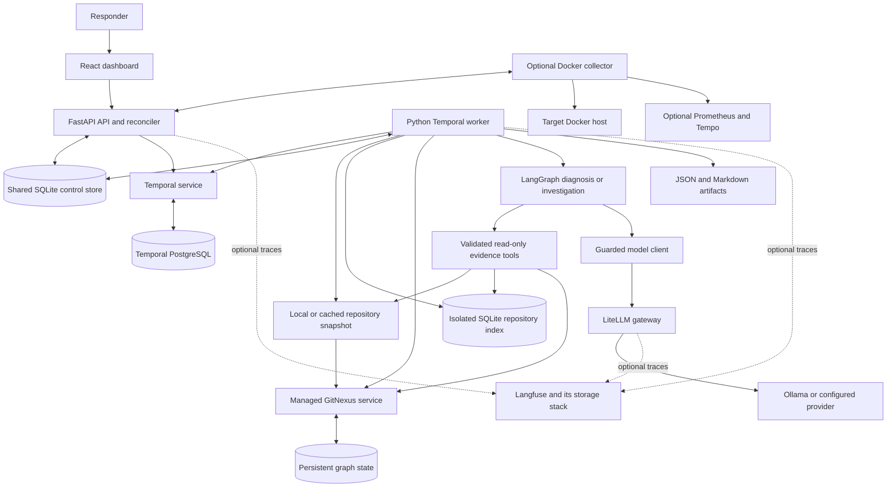
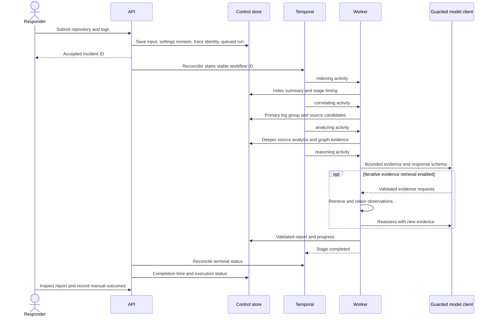

# Incident Copilot architecture

Incident Copilot is a diagnosis-first agentic application for containerized
repositories. It turns supplied errors, source code, and optional runtime observations
into cited hypotheses and manual next checks. It does not execute mitigations, patch
source, or deploy changes.

This handbook describes the implementation in this repository. Read it in order for
onboarding, or follow a chapter for the subsystem you are changing. Defaults describe
the checked-in configuration; a saved settings revision can change a particular run.

## Handbook

| Chapter | Questions it answers |
| --- | --- |
| [Temporal workflows](architecture/temporal-workflows.md) | What are the stages? Who retries work? How do submissions, cancellation, and recovery work? |
| [LangGraph and agentic patterns](architecture/langgraph-and-patterns.md) | Which nodes run? What state changes? How do the fixed and ReAct-style flows differ? |
| [Evidence, indexing, and tools](architecture/evidence-and-tools.md) | How do logs lead to source locations? How are code graphs and runtime observations retrieved? |
| [Memory and context engineering](architecture/memory-and-context.md) | What is saved, reused, checkpointed, and actually sent to the model? |
| [Agent harness](architecture/agent-harness.md) | How do validation, NeMo Guardrails, LiteLLM, and Langfuse surround the reasoning loop? |
| [Operations and assurance](architecture/operations-and-assurance.md) | What are the defaults, failure paths, deployment constraints, and quality checks? |

For startup instructions, use the [README](../README.md). Feature guides linked from
the chapters remain the references for configuration commands and operational procedures.

## Names used in this handbook

| Term | Meaning here |
| --- | --- |
| Temporal workflow | Durable scheduling and recovery of incident-analysis activities. |
| LangGraph graph | Nodes/transitions for diagnosis reasoning and investigation state. |
| Code graph | GitNexus's static source relationships, used as evidence; separate from the LangGraph execution graph. |
| ReAct-style loop | Assessment, evidence action, observation, and reassessment in iterative diagnosis. |
| React dashboard | The frontend UI framework; unrelated to the ReAct investigation pattern. |
| Agent harness | Application controls and supporting services around the model and its evidence tools. |

## System responsibilities

Three layers explain most of the design:

1. **Durable execution:** Temporal schedules activities; the shared control store
   records dashboard submissions, configuration revisions, evidence, and reports.
2. **Evidence and reasoning:** deterministic code localizes the failure. One of two
   LangGraph flows interprets curated evidence: a fixed diagnosis sequence or an
   optional bounded investigation that requests more evidence.
3. **Agent harness:** application code controls tool access, source identity, budgets,
   structured responses, validation, policy checks, model routing, and tracing.

Temporal retries recover work after failures. The investigation loop asks new evidence
questions. They serve different purposes. The two LangGraph flows are alternatives;
the fixed graph does not contain or wrap the iterative graph.

The standard Compose deployment runs API, worker, Temporal/PostgreSQL, LiteLLM, and
GitNexus. The API serves the built React application. The Docker collector is a
separate deployment; Langfuse is an optional Compose overlay. A direct Ollama adapter
can bypass the gateway when explicitly configured.

## One incident from submission to handoff

For example, a checkout timeout might point to `save_order`. Correlation finds that
function, the code graph exposes a possible call to a connection-pool helper, and
iterative retrieval reads the helper to test a connection-acquisition explanation.
Configured runtime evidence might support or weaken that explanation. The report
retains citations, unresolved gaps, and distinguishing checks. A responder performs
the checks and records observations. This is an illustrative path, not a guaranteed
diagnosis or a claim that the static call ran during the failure.

The [reasoning chapter](architecture/langgraph-and-patterns.md#worked-investigation)
walks through the example in state terms.

## Trust and capability boundaries

| Boundary | Implemented control and limitation |
| --- | --- |
| Responder to local console | Published ports bind to localhost; the API rejects unrelated browser write origins. There is no user authentication or tenant isolation. |
| Worker to repository | Compose mounts source read-only. Iterative source retrieval verifies clean commit, index identity, relative paths, and symbol ranges. Local fixed diagnosis has fewer source-verification prerequisites than iterative retrieval. |
| Logs/source/runbooks to model | Treated as untrusted evidence; bounded context, redaction, schema validation, citations, and optional NeMo checks apply. |
| Model to tools | Only six typed evidence operations are exposed. Repository roots, endpoints, credentials, commands, and runtime scope are application controlled. |
| Collector to Docker | Docker access remains in the collector. Socket access carries host-level privilege; API and worker do not require the socket. |
| Application to model provider | Default HTTP route is the OpenAI-compatible adapter through LiteLLM. Schema errors and provider failures are handled by the application. |
| Application to telemetry | Content capture is optional and redacted; metadata is the default. Tracing failure must not prevent diagnosis. |
| Application to disk | The control store can contain raw inputs and credentials. Filesystem permissions protect it; application encryption at rest is not implemented. |

## What the design establishes

Deterministic localization makes the starting candidates reproducible for a given
index and input. Evidence identifiers and source/runtime provenance make observations
inspectable. Validated output distinguishes provisional diagnosis from insufficient
evidence. Budgets bound the investigation; checkpoints and a request journal recover
completed work without resetting those budgets.

These controls establish execution and provenance properties. They do not prove
causation, complete graph coverage, calibrated confidence, prompt-injection immunity,
or better diagnosis quality. This is a single-investigator design, with optional
review using the configured model; it does not implement a multi-agent team.

## Maintaining the handbook

Update documentation in the same change that modifies architectural behavior.

| Change | Required documentation review |
| --- | --- |
| Activity stages, dispatch, retries, cancellation, workflow patches, entry points | Temporal chapter and workflow guide; sequence and execution diagrams |
| Graph nodes, transitions, shared state, review policy | LangGraph chapter; node/state tables and both graph diagrams |
| Parsers, ranking, source snapshots, graph provider, tool contracts, collector | Evidence chapter and corresponding feature guide |
| Checkpoint/journal layout, caches, prompt selection, clipping, citations, budgets | Memory/context chapter; storage and context diagrams |
| Validation, redaction, guardrails, adapters, gateway, trace handling | Harness chapter; failure behavior and configuration references |
| Defaults, volumes, deployment, evaluation, confidence or responder outcomes | Operations chapter and corresponding setup/feature guides |

Before merging a documentation change, verify source links, render diagrams where
supported, check defaults against code and Compose, and trace the affected behavior
through its callers and tests. Label examples as illustrative. Keep setup commands in
feature guides and explain their architectural role here to avoid duplicate procedures.

Implementation entry points: [Temporal workflows](../src/incident_copilot/workflows/temporal_workflows.py),
[dashboard stages](../src/incident_copilot/dashboard/activities.py),
[reasoning selection](../src/incident_copilot/graph/diagnosis_graph.py), and
[deployment](../docker-compose.dev.yml).
