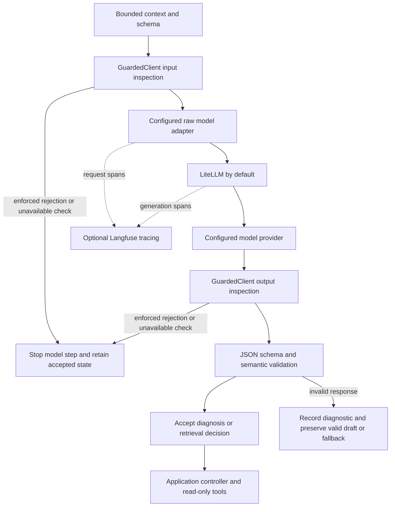

# Agent harness: execution controls, models, and observability

[Architecture handbook](../architecture.md) · [Previous: Memory and context](memory-and-context.md) · [Next: Operations](operations-and-assurance.md)

The harness is the application code around the model. It decides what evidence the
model sees, what actions are possible, how output is accepted, when execution stops,
and what is recorded. LangGraph provides transitions and checkpointing; the harness
supplies the contracts and controls that make those transitions useful.

## Model request and acceptance path



With guardrails off, `get_client` returns the raw adapter. Direct Ollama bypasses
LiteLLM. Input policy classification uses an unguarded internal client to avoid
recursion; it still uses the configured adapter/provider and tracing.

## Application controls

| Control | Implementation and boundary |
| --- | --- |
| Structured generation | Shared schemas via Ollama `format` or OpenAI-compatible `response_format` with JSON schema and `strict: true`; schema also appears in prompt context. |
| Response validation | JSON parsing, Pydantic types/ranges/extra-field rejection, consecutive unique ranks, decision coherence, hypothesis identity, known citations, and action-plan consistency. |
| Evidence provenance | Repository/revision or runtime provenance, verified file/range/symbol identity, stable IDs, scope and clipping metadata. Valid citation origin is distinct from causal correctness. |
| Tool authority | Six read-only operations; immutable repository/runtime scope; no model-selected shell, test execution, edits, deployments, arbitrary query languages, credentials, or URLs. |
| Bounded execution | Transactional reservations, model/request/round/content limits, original deadline, duplicate requests, no-new-evidence detection, and source/graph-generation checks. |
| Failure containment | Retain last validated assessment when later work fails; otherwise deterministic insufficient evidence with useful next checks. Optional graph/tracing failures do not erase normal diagnosis. |
| Redaction | Configured credentials and recognizable secret patterns redacted at relevant evidence, report, HTTP, and telemetry boundaries. Raw control-store inputs/configuration still require private storage. |

Typed `validation_errors` distinguish JSON, schema, semantic, and limit failures and
identify stage, model call/request, field paths, stable codes, and safe explanations.
They omit rejected values and raw exception context. Policy findings use a separate
`guardrails` summary. Failed review records review diagnostics without discarding a
previously accepted draft.

## NeMo Guardrails policy layer

The implementation uses **NeMo Guardrails**, not Neo4j. The optional dependency is
pinned to `nemoguardrails==0.24.1`; Docker includes it. Packaged YAML/Colang policies
register custom input/output actions and call `LLMRails.check_async()`.

| Mode | Effect |
| --- | --- |
| `off` | No SDK initialization or inspections. |
| `observe` (default) | Record flagged/unavailable checks and continue with original diagnosis input/output; existing redaction still applies. |
| `enforce` | Reject the affected model step when checks flag content or cannot complete. Earlier accepted findings remain available; no accepted assessment yields deterministic insufficient evidence. |

Input inspection classifies a redacted copy of the untrusted content actually
selected for the request: logs, source, tool results, runbooks, and prior model text.
Application instructions and schemas are excluded. The classifier returns only a
validated boolean injection verdict. It does not sanitize or rewrite the diagnosis
prompt. Output inspection is local secret detection over model text, including JSON
tool arguments; recognizable placeholders/redaction markers are permitted.

Only fixed marker messages enter the NeMo runtime. Actions access per-analysis
content in memory. Diagnostics retain codes, identifiers, timings, and counters,
not matching secrets or classifier explanations. The policy version hashes packaged
rules and the secret-detector version.

Each investigation permits eight input/output checks, separate from four diagnosis
assessment/review calls. Distinct successful input checks can each add a classifier
model call; output inspection uses no model. Each check defaults to ten seconds;
iterative checks also share its original deadline. Inspection bounds are 32 KiB input
and 64 KiB output. Oversized input, missing SDK, invalid verdict, timeout, and changed
configuration are unavailable checks. Checks do not automatically retry.

Reservations and cached verdicts persist in the request journal. Cache identity
includes content, stage, policy, and relevant settings. Interrupted checks and changed
policy/settings do not become cached passes. Enforced reason codes include
`guardrail_input_blocked`, `guardrail_output_blocked`, and
`guardrail_check_unavailable`.

This is injection classification and limited secret-disclosure detection. It is not
a general moderation service, comprehensive secret scanner, grounding verifier, or
proof of safety. Start with observation and independently inspect false positives,
misses, and latency before enabling enforcement. See [guardrail operations](../guardrails.md).

## LiteLLM gateway and adapters

The default route is:

```text
Diagnosis / investigation / policy classifier
  → configured model client
  → OpenAI-compatible HTTP adapter
  → LiteLLM model alias incident-diagnosis
  → configured upstream (Ollama by default)
```

LiteLLM runs as a separate container; the API/worker do not embed its Python SDK.
`configs/litellm.yaml` maps the stable alias to `LITELLM_MODEL`, `LITELLM_API_BASE`,
and `LITELLM_API_KEY`. The application holds the gateway credential; upstream keys
normally remain in gateway environment. Master-key authentication is required in
the bundled Compose stack. The gateway configuration is mounted read-only.

Both adapters send temperature zero and schema-constrained output. The OpenAI-compatible
adapter calls `/chat/completions`; direct Ollama calls `/api/generate` without streaming.
`drop_params: false` preserves unsupported-parameter errors rather than dropping schema
requirements. Application validation remains necessary even with schema enforcement.

| Timing boundary | Current checked-in value |
| --- | --- |
| LiteLLM router timeout | 300 seconds |
| LiteLLM retries | Zero |
| OpenAI-compatible and direct Ollama HTTP client timeout | 315 seconds |
| Enhanced single-pass generation/review shared deadline | 315 seconds; baseline has no additional shared wall-clock timeout wrapper |
| Selective review call | Maximum sixty seconds, constrained by remaining deadline |
| Iterative investigation | Original 180-second deadline, including assessments, retrieval, policy checks, and recovery downtime |

An `httpx` timeout is a client I/O timeout, not an unlimited guarantee of total
workflow duration. The iterative `asyncio` deadline can cancel a model wait earlier
than gateway/client timeout. Temporal stage timeouts are a further outer boundary.
Account for all layers before enabling provider retries or fallbacks.

The bundled gateway is file-configured and has no database: no persistent spend
ledger, virtual-key management, or gateway budget enforcement is configured. Multiple
routes/provider fallbacks are possible configuration extensions, not the default
implemented routing policy. Health and authenticated `/v1/models` checks establish
reachability, not successful inference or schema support. See [gateway setup](../litellm.md).

## Langfuse and OpenTelemetry

Langfuse is optional and disabled outside its overlay by default. The local overlay
adds a web/worker pair plus dedicated PostgreSQL, ClickHouse, Redis, and MinIO storage.
The API, worker, and gateway do not depend on Langfuse health.

Each execution has a stable trace identity. Dashboard submissions persist it before
dispatch; retries retain it and reruns get a new identity. Temporal interceptors carry
trace context in workflow headers. The HTTP adapter injects W3C `traceparent` into
gateway requests, allowing LiteLLM OTel v2 generations to appear beneath application
request spans. Headers contain identifiers, not prompts or credentials.

| Observation | Contents and interpretation |
| --- | --- |
| Application spans | Indexing, correlation, analysis, graph/source/runtime retrieval, diagnosis, review, guardrails, and model requests. |
| Gateway generation | Reported provider usage and available cost; app request spans do not duplicate generation usage. |
| Direct Ollama generation | `prompt_eval_count` and `eval_count`; cost and section-token estimates unavailable. |
| `prompt.composition` | Categories for final clipped system/log/source/graph/runtime/runbook/hypothesis/schema context and evidence IDs/kinds; section counts are estimates. |
| Content capture | Metadata-only default; explicitly enabled redacted model input/output on app request spans. Nested gateway generations remain metadata-only. |

Token accounting uses LiteLLM's authenticated local-tokenizer endpoint with provider
counting disabled. It is off the critical path: two background workers, thirty-two
pending jobs, three-second job budget, one-second HTTP timeout, and a 512-section cache
with sixty-second TTL. Unavailable counts stay unavailable rather than becoming zero.
Estimates may not sum to provider usage due to token boundaries, wrappers, and schema
overhead. Current clients do not stream; time to first token is unavailable.

Telemetry scrubs configured credentials, repository tokens, recognizable secret
assignments/URLs, and private keys. Export masking removes exception bodies, stack
traces, and raw third-party events. It is best effort, not comprehensive PII detection.
Observability settings are process environment settings, separate from immutable
analysis configuration revisions; changes require process recreation/restart.

Trace history is for operators and evaluation. The investigator does not query
Langfuse as runtime evidence or long-term memory. See [Langfuse setup and smoke checks](../langfuse.md).

## Source and verification map

- [Client selection](../../src/incident_copilot/llm/client.py), [OpenAI-compatible adapter](../../src/incident_copilot/llm/adapters/openai_compatible.py), [Ollama adapter](../../src/incident_copilot/llm/adapters/ollama.py), [gateway configuration](../../configs/litellm.yaml).
- [Validation](../../src/incident_copilot/llm/validation.py), [structured output](../../src/incident_copilot/llm/structured_output.py), [action-plan validation](../../src/incident_copilot/analysis/recommendations.py).
- [Guarded client and NeMo actions](../../src/incident_copilot/llm/guardrails.py), [packaged policies](../../src/incident_copilot/llm/policies/), [guardrail tests](../../tests/unit/test_guardrails.py), [pipeline tests](../../tests/test_guardrails_pipeline.py).
- [Observability runtime](../../src/incident_copilot/observability/runtime.py), [prompt categories](../../src/incident_copilot/observability/prompts.py), [token estimates](../../src/incident_copilot/observability/tokens.py), [tracing tests](../../tests/unit/test_observability.py).
- [Gateway deployment tests](../../tests/test_litellm_compose.py), [Langfuse overlay](../../docker-compose.langfuse.yml), [overlay tests](../../tests/test_langfuse_compose.py).
