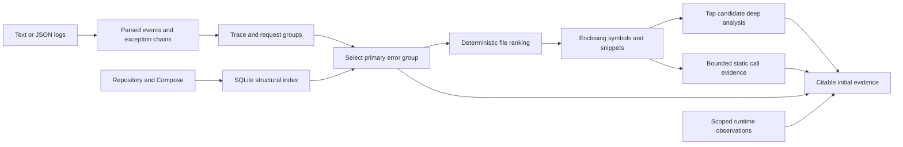

# Evidence, repository knowledge, and tools

[Architecture handbook](../architecture.md) · [Previous: LangGraph](langgraph-and-patterns.md) · [Next: Memory and context](memory-and-context.md)

Evidence acquisition begins before the LLM. The application parses the incident,
finds likely source locations, and constructs bounded observations. Iterative mode
can then ask additional evidence questions through a small read-only interface.

## From logs to candidate locations

Plain text, Compose-prefixed lines, JSON records, stack frames, and explicit exception
chains become events with original line ranges, observed service metadata, timestamps,
and request/trace IDs. Trace IDs associate events across services; request IDs associate
events only when they do not bridge conflicting traces. Similar timestamps alone do
not merge unrelated errors. Explicit exception causality is retained separately from
chronological ordering.

Exactly one group supplies diagnosis evidence. Selection prefers error-bearing groups,
then an observed service matching the hint when present, then highest candidate score,
with original input order breaking ties. All other groups remain visible context in
reports/UI. Hints do not manufacture observed service ownership.

`score_file` applies fixed signals: exact stack path +32, suffix path +22, basename
+6, matching stack function +12, and service match +8, with weaker path/symbol/import/
environment/entity hints. A repeated traceback frame does not multiply the same
signal. These numbers rank locations; they are not probabilities or causal confidence.
`rank_candidates` resolves enclosing symbol ranges and loads source snippets for the
top candidates. Default candidate count is ten.

## Structural indexing

The primary index is custom Python code using Tree-sitter and SQLite, running inside
the worker. It is not an external search service, vector database, embedding pipeline,
or compiler-complete semantic index.

| Step | Implemented behavior |
| --- | --- |
| Discover | Walk supported Python, JS/JSX, TS/TSX, Go, Java, JSON, and YAML files; prune common VCS/dependency/cache/build directories and skip symlink files. This is a fixed exclusion list, not general `.gitignore` evaluation. |
| Map services | Parse Compose metadata; associate files with service build contexts. Multiple services can share a context, so ownership remains a hint. |
| Parse symbols | Tree-sitter extracts definitions and one-based ranges; TSX uses its own grammar. JSON/YAML produce no code symbols. |
| Fall back | Missing/failed grammar uses Python AST for Python or lightweight extraction for other languages. A parser child crash/timeout disables that grammar for the rest of the run and uses fallback. |
| Extract clues | Text patterns collect imports, environment references, and possible routes; coverage is limited and language-dependent. |
| Persist | `metadata`, `services`, and `files` SQLite tables store source identity and JSON records. A transaction replaces the snapshot atomically. |

Native parsing runs in a spawned child process, with thirty-second startup and
per-file limits, outside the API/worker's native process. Deep analysis is separate:
Python AST collects functions, classes, imports, and raises; JS/TS analysis currently
uses text patterns for exported functions, classes, and imports. Other languages
return a no-native-analysis note. Default deep-analysis count is five candidates.

Local submissions build an isolated run index. GitHub sync prepares a source/index
snapshot, and each incident copies a compatible database through SQLite backup;
incompatible prepared metadata can trigger a local rebuild. Fresh indexing scans
supported files and replaces the snapshot, rather than incrementally updating changed
files. Ranking reads file records and scores them in Python.

## Source identity and code graph

Local profiles refer to worker-accessible paths. GitHub profiles use the last manually
synced commit-specific snapshot. Deployed-version linking can instead prepare the
commit declared by the emitting container. Reruns retain the original pinned source
where supported. A declared commit is source linkage, not verification of runtime
file contents. See [repository sources](../repositories.md) and
[deployed versions](../deployed-versions.md).

GitNexus is a separate managed graph service, enabled by default. It prepares/reuses
per-repository static call indexes for clean committed checkouts. Initial analysis
uses at most three localized seeds and twenty related symbols. Preparation may wait
up to 300 seconds; retrieval has its own fifteen-second deadline. Source/index
revision, exact file/range identities, and graph freshness are checked. Later iterative
lookups must retain the captured graph generation rather than refreshing it mid-run.

Graph context records provider/version, revisions, timestamp, verified symbols,
directed `CALLS` edges, per-seed outcomes, status, completeness, and limitations.
Statuses include `available`, `partial`, `skipped`, and `unavailable`. Graph evidence
adds no deterministic candidate score. Static calls do not prove runtime execution;
dynamic dispatch, reflection, framework boundaries, provider windows, and clipping
limit coverage. Failure preserves normal diagnosis with a reason.

Managed state and authentication are separate persistent volumes. The manager
deduplicates preparation, serializes writers, coordinates its read-only MCP child,
and verifies successful preparation markers. External mode retrieves from an already
prepared service and does not manage preparation. See [code graph operations](../code-graph.md).

## Read-only investigation tools

The model requests tools through `EvidenceRequest`. Each request includes `tool` and
an evidence `question`; structured policies additionally tie questions to a hypothesis
or explicitly identified gap. Arguments below are the meaningful selectors; common
filters include repository-relative file path, service, language, and bounded `limit`
where supported. The model cannot select a different repository or runtime endpoint.

| Tool | Main arguments | Result and restrictions |
| --- | --- | --- |
| `find_symbols` | `query`, optional file/service/language filters, `limit` | Indexed symbol-name matches with exact ranges, total/ambiguity metadata, and clipping; does not resolve types or prove usage. |
| `read_source` | Exact `symbol` reference or `file_path`, optional start/end lines | Redacted source range, location, clipping, and next-line hint. Maximum eighty lines; content is further clipped to leave room in the response envelope. |
| `search_source` | Literal `query`, optional file/service/language filters, `limit` | Line matches from redacted indexed files; no arbitrary regex, shell, or unindexed filesystem search. |
| `get_file_context` | `file_path` | Indexed language, imports, env references, routes, service hints, symbols; navigation metadata rather than data flow. |
| `get_related_calls` | Exact `symbol`, `direction` incoming/outgoing/both, `limit` | One-hop verified callers/callees, bounded to twenty related symbols across the investigation. No arbitrary graph queries or unrestricted traversal. |
| `get_runtime_evidence` | `capability`, optional scoped `service`/observed `trace_id`, `lookback_minutes` | Scoped logs, resources, dependency observations, traces, or latency evidence through the collector. Requires a runtime client; maximum four follow-ups within the shared twelve-request budget. |

`SymbolReference` identifies `file_path`, `name`, `line_start`, and `line_end` exactly.
Source tools require an unchanged clean revision, a matching index root/revision,
verified indexed locations, and paths contained by the trusted root. A changed or
unverified snapshot disables source retrieval. Runtime-aware tools can continue with
independent runtime observations and an explicit source gap.

`ToolOutcome` contains `request_id`, `tool`, `status` (`ok`, `empty`, `unavailable`, or
`invalid`), optional reason, evidence, graph context, duration, and validation diagnostic.
Source responses are capped at 8 KiB including the outcome envelope; clipping adjusts
line ranges and can omit items. Empty results establish only the searched scope.

Evidence items carry a stable ID, kind, location/content/data, request ID, limitations,
and truncation flag. Source observations carry repository/revision; runtime observations
carry runtime provenance rather than a fabricated source identity. Application code
validates references before accepting model claims. A valid reference proves origin,
not support for the claimed mechanism.

## Runtime evidence path

The standalone Docker collector discovers Compose projects and sends bounded error
windows through authenticated ingestion. Enabled mappings choose the repository and
whether errors can create investigations. Repeated fingerprints update Issues, with
bounded investigation creation; duplicate delivery is acknowledged idempotently.

Runtime-enabled deployment-linked incidents enqueue five automatic snapshot requests.
The helper polls outbound work, leases requests, performs fixed-scope reads, and
returns normalized evidence. API/worker containers do not need Docker access. Durable
requests, leases, deadlines, scope, and completed results survive API/worker restarts.
The resource sample buffer is in memory; collector restarts lose that sample history.

Scope is pinned to the original collector, project, environment, containers, incident
anchor, configured dependencies, and observed trace identifiers. Defaults include a
five-minute lookback (maximum fifteen), five services/ten containers, thirty-second
automatic collection deadline, fifteen-second follow-up deadline, and thirty automatic
backend reads. Requests never substitute a new same-service container for the original.

Optional Prometheus/Tempo adapters use operator-owned profiles and query templates.
The investigator cannot submit arbitrary PromQL, SQL, URLs, credentials, or active
probes. Health snapshots are collection-time observations; counters do not prove
connectivity; individual trace durations are not service-wide percentiles. Missing
telemetry remains an explicit gap. See [runtime evidence](../runtime-evidence.md).

## Runbooks and manual recommendations

Runbooks under the analyzed repository's `docs/runbooks/` are selected by observed
primary-group service/error metadata, not model claims. Discovery scans at most one
hundred Markdown files, selects at most three, and caps each at 8 KiB. Reports retain
section excerpts, line ranges, source revision, and file hash. Runbooks are untrusted
context, not instructions granting execution authority.

Validated action plans contain supporting claims, evidence gaps, distinguishing checks,
runbook references, and mitigation proposals with prerequisites, risks, rollback, and
recovery criteria. Missing prerequisites block a proposal. All actions remain manual;
the investigation tool list exposes no test execution, patching, shell, or deployment.
See [actionable recommendations](../actionable-recommendations.md).

## Source and verification map

- [Log parser](../../src/incident_copilot/correlation/log_parser.py), [candidate ranker](../../src/incident_copilot/correlation/candidate_ranker.py), [scoring](../../src/incident_copilot/correlation/scorer.py).
- [Repository indexer](../../src/incident_copilot/indexing/repo_indexer.py), [storage](../../src/incident_copilot/indexing/storage.py), [isolated parser](../../src/incident_copilot/indexing/isolated_parser.py), [deep analysis](../../src/incident_copilot/analysis/dependency_probe.py).
- [Graph retrieval](../../src/incident_copilot/analysis/code_graph.py), [manager](../../apps/codegraph/manager.mjs), [evidence tools](../../src/incident_copilot/analysis/evidence_tools.py), [runtime routing](../../src/incident_copilot/analysis/runtime_tools.py), [contracts](../../src/incident_copilot/schemas/investigation.py).
- [Collector source](../../collector/), [runtime service](../../src/incident_copilot/dashboard/runtime_evidence.py), [runbook loader](../../src/incident_copilot/analysis/runbooks.py).
- [Localization tests](../../tests/unit/test_candidate_localization.py), [tool tests](../../tests/unit/test_evidence_tools.py), [graph tests](../../tests/unit/test_code_graph.py), [runtime tests](../../tests/test_runtime_evidence.py).

Further details: [indexing](../indexing.md), [incident timelines](../incident-timeline.md).
