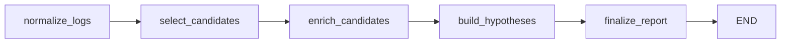
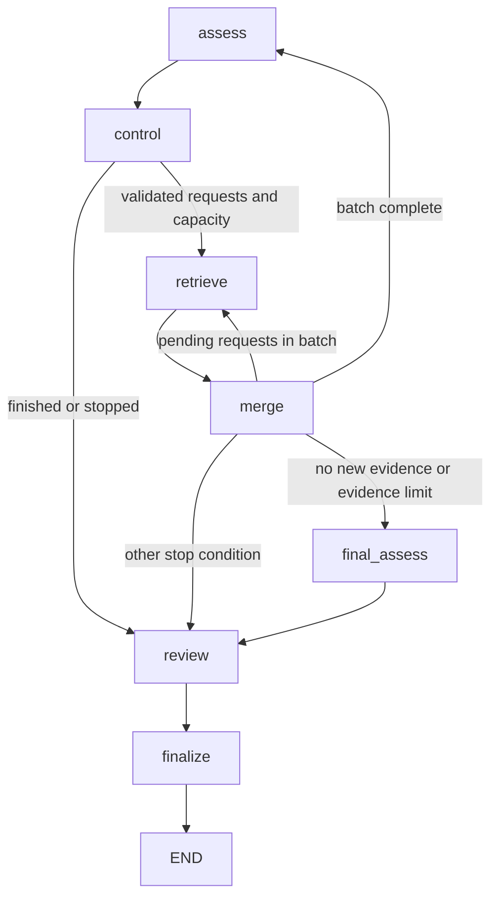

# LangGraph workflows and agentic design patterns

[Architecture handbook](../architecture.md) · [Previous: Temporal](temporal-workflows.md) · [Next: Evidence and tools](evidence-and-tools.md)

The reasoning stage receives evidence already localized by deterministic code.
`run_diagnosis_graph` loads applicable repository runbooks and selects one of two
flows. `agentic_enabled=False` selects fixed diagnosis; `True` attempts iterative
investigation. Missing runtime context, optional dependencies, or an unverified
source-only snapshot cause an explicit downgrade to fixed diagnosis with an incomplete
investigation summary. Runtime-enabled investigations can continue without source.

## Implemented patterns

| Pattern | Implementation | Decision owner |
| --- | --- | --- |
| Fixed workflow / prompt chaining | A prescribed sequence prepares evidence, generates a structured diagnosis, and finalizes the summary. Optional review adds a constrained assessment. | Application owns sequence; model supplies diagnosis |
| Bounded ReAct-style investigation | Model assesses observations, requests evidence, receives tool results, and reassesses until finished or limited. | Model proposes evidence requests; controller validates and schedules them |
| Controller and tool boundary | Typed requests, immutable scope, budgets, repeated-request detection, and source verification govern actions. | Application |
| Selective review | `structured_review` can qualify, remove, or rerank a draft using existing evidence and remaining capacity. | Configured policy and application gate the review call |
| Durable state machine | LangGraph checkpoints plus a request journal resume completed steps and preserve budgets. Temporal retries the enclosing activity. | Application and orchestration runtimes |
| Human follow-through | Report checks and mitigation proposals are performed manually; observations are saved separately. | Responder |

Here, ReAct means the assessment/action/observation cycle. There is no prebuilt
`create_react_agent`, provider-native `tool_calls` conversation, or exposed private
chain of thought. `client.complete` returns schema-constrained JSON with hypotheses,
evidence questions, and `action: "retrieve"` or `"finish"`. Application code invokes
the requested tools. This makes the loop usable through either model adapter.

## Fixed diagnosis graph

| Node | Reads | Writes / responsibility | External work and failure behavior |
| --- | --- | --- | --- |
| `normalize_logs` | `parsed_log`, `incident_context`, leading candidate | Primary-group log view, `incident_context`, `likely_service`, `likely_error_class` | Local only; retains historical parsing behavior without timeline context |
| `select_candidates` | `candidates`, `candidate_limit` | Descending score order and bounded candidate list | Local only; consumes scores already computed before the graph |
| `enrich_candidates` | Candidate `reasons` | Candidate `evidence_summary` from up to five reasons | Local only; does not fetch graph neighbors or new source |
| `build_hypotheses` | Logs, candidates, deep/graph/runtime evidence, runbooks, source snapshot, reasoning policy | `hypotheses`, diagnosis outcome/reason/checks, retained citable evidence, diagnostics, guardrail and reasoning metadata, engine/fallback | Guarded model request and optional review; no usable candidates/runtime observations or failed/invalid generation produces deterministic insufficient evidence |
| `finalize_report` | Diagnosis outcome, candidate count, likely service/error, incident context | `summary` including analysis scope | Local only; report conversion/export happens outside this node |

Normally this path makes one diagnosis call. `structured_review` can make one extra
review call. Guardrail classifier calls have separate accounting. If LangGraph itself
is unavailable, fixed diagnosis executes these same functions sequentially.

## Iterative investigation graph

Bootstrap first applies the same normalization, candidate selection, and enrichment
helpers, redacts evidence, establishes a trusted snapshot, and creates initial
evidence records. These helpers are not additional registered investigation nodes.

| Node | Reads | Writes / responsibility | External work and failure behavior |
| --- | --- | --- | --- |
| `assess` | Evidence records, working hypotheses, prior retrieval outcomes, policy, journal budget | Validated `assessment_decision`, `working_hypotheses`, assessed request IDs, events, engine, budget, diagnostics | Guarded model call; content-aware cached assessments reused. Deadline, invalid output, or provider/policy failure records a stop and preserves earlier valid hypotheses. |
| `control` | Decision, snapshot, deadline, round/request/model counters, completed requests | Deduplicated `pending_requests`, round reservation, or stop reason | Validates source; honors finish decisions and reserves bounded rounds. It does not call the model. |
| `retrieve` | First pending request, journal cache, remaining budget | `active_request`, `action_result`, budget | Reserves a tool request and executes one read-only tool, or reuses a saved outcome. Exceptions/timeouts become typed outcomes; cancellation propagates. |
| `merge` | Tool outcome, evidence records, pending requests, starting evidence count | Deduplicated evidence, retrieval outcomes, graph context, events, next pending list, diagnostics/progress | Revalidates source, applies retained-content limits, publishes progress; detects empty rounds, changed source/graph, and deadline. |
| `final_assess` | Latest evidence and retrieval outcomes, original remaining capacity | Final validated assessment, hypotheses, assessed request IDs | Calls assessment in finish-only mode. Cannot start further retrieval; exhausted deadline/calls leave outcomes explicitly unassessed. |
| `review` | Last validated decision, evidence, policy, stop reason, remaining calls/deadline | Reviewed decision or preserved draft, `reasoning_draft`, review status, diagnostics | Optional model review. No retrieval. Invalid review or timeout normally retains the draft; enforced policy rejection stops acceptance of the reviewed output. |
| `finalize` | Latest valid hypotheses, evidence IDs, snapshot, stop reason, budgets | Public report state, investigation summary, retained evidence, engine/fallback, summary | Verifies evidence references and source status, converts model scores, persists final journal result, publishes final progress. Without a valid assessment, uses deterministic fallback. |

Each assessment may request up to four operations. Retrieval executes requests
sequentially, merging each result, before reassessment. This is one investigator
making bounded batches of evidence requests, not parallel specialist agents.

### Stopping and final assessment

`control` stops on a finish decision, deadline, exhausted round/request/model budget,
or repeated requests. Assessment switches to finish-only when retrieval rounds or
requests are exhausted, or the last available model call is reached. `merge` routes
empty rounds and retained-evidence exhaustion to `final_assess` so the model can
interpret retrieval outcomes before reporting, when capacity remains.

An empty search only describes its search scope. Unavailable telemetry leaves the
requested observation unknown. `assessed_request_ids` records which outcomes were
included in a validated assessment; any remaining IDs become
`unassessed_request_ids` and an explicit report gap. Delivery to the model does not
prove correct interpretation.

`investigation.incomplete` is separate from `diagnosis_status`. A stopped investigation
can preserve a provisional diagnosis; a completed model assessment can legitimately
return insufficient evidence. Even `model_finished` can retain unresolved gaps.

## Shared state contract

Both graphs use `DiagnosisState`, a `TypedDict(total=False)`: fields may be absent,
especially in historical runs. It has no custom field reducers. Nodes replace the
fields they return; collection updates explicitly copy/merge/deduplicate values.
Pydantic validates model decisions, evidence, and reports at their boundaries.

| Field group | Fields and purpose |
| --- | --- |
| Identity/configuration | `incident_id`, `execution_id`, `candidate_limit`, `source_snapshot`, `source_unavailable`, `action_plan_version` |
| Initial incident context | `parsed_log`, `incident_context`, `omitted_initial_context_count`, `likely_service`, `likely_error_class` |
| Source/runtime knowledge | `candidates`, `deep_analysis`, `graph_context`, `runtime_config`, `runtime_evidence`, `runtime_collection`, `runtime_scope` |
| Runbooks | `runbooks`, `recommendation_limitations` |
| Investigation working memory | `evidence_records`, `working_hypotheses`, `assessment_decision`, `retrieval_outcomes`, `assessed_request_ids` |
| Pending action state | `pending_requests`, `active_request`, `action_result` |
| Control and history | `execution_budget`, `investigation_progress`, `investigation_events`, `investigation` |
| Policy/diagnostics | `reasoning`, `reasoning_draft`, `guardrails`, `validation_errors`, `engine`, `fallback_reason` |
| Report output | `hypotheses`, `diagnosis_status`, `diagnosis_reason`, `next_checks`, `summary`, `retrieved_evidence` |

Clients, credentials, locks, and SDK policy engines live in runtime objects, outside
graph state. The [memory chapter](memory-and-context.md) explains checkpoints,
journal reservations, and prompt projection.

## Reasoning policy is a separate choice

Both execution modes accept `baseline`, `structured`, or `structured_review`:

- `baseline` supplies the standard evidence-constrained diagnosis instructions.
- `structured` adds mechanism, alternatives, contrary evidence, and distinguishing
  checks within the existing assessment calls.
- `structured_review` adds at most one selective review for competing causes,
  conflicting evidence, or an explicit causal gap, when capacity remains.

Review cannot introduce a new cause, request tools, or promote an insufficient-evidence
draft to provisional. It preserves retained hypothesis identity, essential gaps,
contrary citations, and validated action plans. Iterative review shares the four-call
budget and original deadline; useful retrieval takes priority. A reserved review
interrupted by recovery is marked failed rather than consuming another call.

## Worked investigation

This example illustrates transitions; the actual model may choose different requests
or abstain.

1. Logs show an orders-service timeout in `save_order`. Upstream stages select the
   request group, rank that function, and supply a possible static pool-helper call.
2. Bootstrap puts those observations in `evidence_records`. `working_hypotheses`
   starts empty; budget counters start at zero only for a new execution.
3. `assess` proposes connection-acquisition delay and requests `read_source` for the
   helper. The hypothesis cites existing evidence; the question states the gap.
4. `control` validates/deduplicates the request and reserves a retrieval round.
   `retrieve` reads the bounded source range and journals its outcome. `merge` adds
   a source evidence ID, records scope/limitations, and removes the pending request.
5. `assess` receives that observation and the completed request outcome. It revises
   the explanation, requests scoped runtime evidence if available, or chooses finish.
   Source alone may justify only a tentative lead and further manual checks.
6. `review`, if enabled and eligible, checks the existing draft. `finalize` retains a
   provisional or insufficient-evidence outcome and supporting gaps/citations.
7. Report conversion makes diagnosis `confidence` null and retains any raw model
   self-assessment as `model_score`. The responder later records a check as supporting,
   weakening, or inconclusive, and any mitigation/recovery observations. Those events
   do not rerun the graph or rewrite its diagnosis.

## Source and verification map

- [Fixed graph and mode selection](../../src/incident_copilot/graph/diagnosis_graph.py), [fixed node implementations](../../src/incident_copilot/graph/nodes/), [shared state](../../src/incident_copilot/graph/state.py).
- [Investigation graph and decisions](../../src/incident_copilot/graph/investigation.py), [evidence contracts](../../src/incident_copilot/schemas/investigation.py), [review policy](../../src/incident_copilot/llm/reasoning.py).
- [Loop tests](../../tests/unit/test_investigation.py), [limits](../../tests/unit/test_investigation_limits.py), [final assessment](../../tests/unit/test_investigation_final_assessment.py), [review](../../tests/unit/test_diagnosis_review.py), [reasoning policies](../../tests/unit/test_reasoning_pipeline.py).

Feature references: [bounded investigation](../agentic-investigation.md),
[structured reasoning](../structured-reasoning.md), [confidence semantics](../diagnosis-confidence.md).
