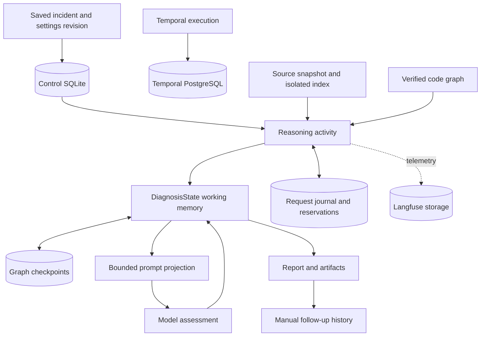
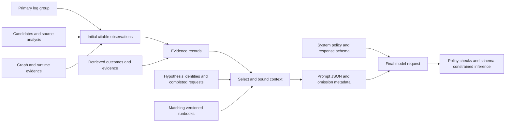

# Memory architecture and context engineering

[Architecture handbook](../architecture.md) · [Previous: Evidence](evidence-and-tools.md) · [Next: Agent harness](agent-harness.md)

The system has several kinds of persisted state, but persistence does not mean all
saved information becomes model memory. The investigator reasons over a bounded
projection of the current incident's evidence. It does not automatically search old
incident diagnoses, learn from responder outcomes, or train model weights.

## Memory responsibilities and storage

Paths below are patterns relative to effective settings. The Compose stack overrides
some host defaults, so use the run's captured paths when locating historical data.

| Layer | Storage and scope | Writer / reader and reuse | Lifetime and limitations |
| --- | --- | --- | --- |
| Workflow execution | Temporal history in its PostgreSQL service, per workflow | Temporal records activity scheduling/results and replay state; worker/client resume or inspect it | Governed by Temporal deployment/retention. Base Compose does not declare an explicit PostgreSQL volume; container replacement is not protected by an application backup. |
| Dashboard control state | `IC_CONTROL_DB_PATH`, default `data/control.db`; shared SQLite | API and worker read/write profiles, inputs/evidence/reports, configuration/revisions, sync jobs, Issues, action outcomes, and runtime requests | Survives process restart when the file is retained. Contains private inputs and credentials; not an encrypted credential vault. |
| Source catalogue | `IC_INDEX_DB_PATH` parent plus `runs/<execution_id>/<index_filename>` | Worker indexes/copies; correlation and source tools read | Isolated per execution. A compatible prepared snapshot can be copied; not a history of model conversations. |
| Prepared source | `IC_REPOSITORY_CACHE_DIR`, default under `IC_DATA_DIR`; Compose `/repository-cache` | Worker sync/deployed-source preparation writes; API/graph read mounted cache | Commit-specific snapshots and prepared indexes retained; no automatic cache pruning. Local profiles instead reference their configured checkout. |
| Code relationships | `gitnexus-state` volume, repository indexes/registry/markers under `/state/repositories` | Managed graph service prepares and retrieves; workers consume verified results | Reusable for matching source revisions; stale/unverified generations rejected. Separate `gitnexus-auth` volume stores shared authentication. |
| Working investigation | `DiagnosisState`, per execution | Nodes explicitly update evidence, decisions, hypotheses, requests, progress, and output | In-memory active state; persisted by iterative graph checkpoints. Fixed graph does not install this checkpointer. |
| Graph checkpoint | `IC_DATA_DIR/investigations/<execution_digest>/checkpoints.sqlite` | LangGraph `AsyncSqliteSaver`, keyed by execution ID as `thread_id` | Iterative completed node state and next step survive retry. Uses synchronous checkpoint durability at graph invocation. |
| Request journal | Same investigation directory, `requests.sqlite`; `execution.lock` serializes attempts | `InvestigationStore` saves reservations, budget, snapshot, assessment/tool results, graph symbols, guardrail verdicts, reasoning config, final output | Supplements checkpoints to protect interrupted node work. Does not reset limits after restart; external request completion can precede local persistence. |
| Legacy log snapshots | Content-addressed `incident-context-*` records in control-store `revisions` | Legacy Temporal correlation offloads; diagnosis/report consumers hydrate with hash checks | References require the original control store; these records are parsed snapshots, not settings revisions despite sharing a table. |
| Report artifacts | `IC_DATA_DIR/incidents/<incident_id>/report.json` and `report.md` for dashboard runs | Reasoning activity writes; API exports the report and overlays current follow-up history | Stored artifacts retain original diagnosis; moving settings does not relocate old files. CLI writes only requested output files. |
| Collector buffering | `collector-data` volume at `/var/lib/vector`; helper resource samples in memory | Vector buffers outbound logs on disk; helper serves bounded sampled history | Disk buffer survives collector restarts; in-memory resource history does not. Runtime request/results also persist in control store. |
| Observability | Optional Langfuse PostgreSQL, ClickHouse, Redis, and MinIO volumes | App/gateway export traces; UI/operators inspect | Operational telemetry, not evidence automatically fed into diagnosis. Metadata-only by default; separate backup/retention responsibility. |

## Recovery identity and consistency

The execution ID binds the run index, graph thread, journal, and trace identity.
The investigation directory uses a deterministic digest of that ID. An execution
lock serializes overlapping attempts. A new rerun has a new execution ID; a retry
of the same activity does not.

The journal reserves model calls, retrieval rounds, and tool calls transactionally
before execution. Request identity hashes source repository/revision (or runtime
scope) and normalized tool arguments. Question wording and hypothesis ID do not
make the same operation new. Completed outcomes are reused. Assessment caching also
includes round/evidence identity, retrieval outcomes, and terminal mode; old compatible
cache keys remain readable.

Checkpoint resume does not replace initial inputs with a retry's freshly assembled
payload. Captured source/index identity and graph generation remain authoritative.
Reasoning mode and prompt version are pinned in the journal; older unversioned
executions resume as baseline. A missing compatible prompt version finalizes existing
state with a recorded limitation rather than silently changing reasoning policy.

An interrupted external read or model call may repeat if no result was saved. Its
reservation remains consumed. Review reservations and guardrail reservations have
their own interruption handling. Exactly-once side effects are not promised; evidence
tools are read-only and the model cannot execute remediations.

## Context construction

### Initial evidence

Both modes use `initial_evidence` to construct stable, citable observations. Source
identity, observation kind/content/data, and location participate in initial IDs.
Items include log summary, primary-group events, exception chains, candidate snippets,
file analysis, graph context, analyzed runtime configuration, and runtime observations.
Each initial item is capped at 8 KiB and the initial pool at 64 KiB; omissions are
counted. Candidate snippets are further limited to eighty lines and 4 KiB. Event
messages are clipped to two thousand characters with a limitation.

Collection and model context are different: retaining an item in evidence storage
does not guarantee space in every subsequent prompt. Other trace/request groups are
available for inspection but excluded from the diagnosis context.

### Fixed-mode prompt

`build_diagnosis_prompt` includes citable observations, log summary and bounded primary
events, candidates, deep analysis, code graph, runtime configuration/evidence/collection,
runbooks, and the response schema. It measures UTF-8 prompt plus system text against
32 KiB. The response schema is embedded in that prompt as well as passed to the adapter.

To fit, it removes deep-analysis entries, the separate graph context, runtime evidence,
candidate summaries, runtime configuration, primary events, error lines, runtime
collection entries, runbooks, then citable observations, in that order. Removed separate
summaries can still have corresponding citable records until those records are removed.
The final retained observations become `retrieved_evidence`; citation validation uses
that retained set. Runbook/evidence omissions and primary-event omission counts are
reported; not every removed duplicate summary has an individual omission record.
An envelope that still cannot fit fails with a typed `prompt_limit` diagnostic.

### Iterative prompt

`build_investigation_prompt` rebuilds bounded JSON for each assessment rather than
appending an unlimited chat transcript. There is no separate model-driven conversation
compaction or summary-memory step. It budgets system text, response schema, and
envelope space within 32 KiB. It includes:

- Task/finish-only instructions, consumed counters, and retrieval stopping reason.
- Initial candidate identifiers and compact previous hypothesis identity/title/citations.
- Prior unresolved gaps and completed request outcomes with question, scope, status,
  reason, retained evidence IDs, clipping, and omissions.
- Selected evidence, omitted evidence IDs, applicable runbooks, primary-group scope,
  runtime scope/collection, and source-availability information.

Selection prioritizes the log summary, already-cited observations, strongest candidate,
and newly retrieved evidence ahead of other static context. Within priorities it starts
from recent records. Runbooks and evidence are trimmed to fit; an oversized envelope
can reduce previous hypotheses/candidates and report a prior-context gap before failing.
Serialized JSON is never truncated mid-value.

Finish-only assessments include retrieval outcomes even when no evidence was found,
so empty/unavailable reads can be interpreted as scoped results rather than invented
observations. Reports expose outcomes not delivered to any validated assessment.

### Review context and instruction boundaries

Selective review receives the validated draft and original retained evidence/runbooks.
It prioritizes preserving cited observations, bounds other context, and cannot retrieve
new evidence or add new causes. The policy view used for input inspection contains
untrusted evidence and prior model text, excluding application instructions and schema.

System instructions, schemas, trusted runtime objects, and evidence have separate
roles. Logs, code comments, runbooks, retrieval results, and previous model output
cannot authorize new tools, change budgets, or select credentials/endpoints. NeMo
inspection supplements these application controls; see [the harness](agent-harness.md).

## Limits are bytes and counts, not model-token guarantees

| Boundary | Current bound |
| --- | --- |
| Initial observation / initial evidence pool | 8 KiB / 64 KiB |
| Retrieved content retained by iterative merge | 64 KiB, counted separately from initial items |
| Serialized model-input accounting | 32 KiB; mode-specific assembly as described above |
| Source tool response | Eighty lines; 8 KiB total outcome envelope, with smaller content clipping |
| Iterative retrieval | Three rounds, four requests per decision, twelve total requests |
| Assessment and optional review | Four model calls, original 180-second deadline |
| Runtime follow-ups | Four within the shared twelve-request allowance |

The initial pool and later retrieved-content pool have separate accounting. Provider
message wrappers and schema transport can add overhead. Langfuse section token counts
are estimates for observability, not the controller's budget enforcement mechanism.

## Long-lived knowledge and feedback

Repository snapshots, structural indexes, static graphs, and versioned runbooks are
reusable code knowledge. Incident reports, recurring Issues, and responder outcomes
are retained operational history. Neither is an automatic vector-memory service.

Reruns create new investigations using captured input/source where applicable. They
do not seed hypotheses from previous reports or copy manual follow-up history.
Responder events are appended and overlaid on dashboard exports; they do not rerank
the saved diagnosis, close Issues automatically, or train the model. Human-labeled
evaluation datasets are a separate offline quality process.

No automatic incident/artifact/checkpoint garbage collection or learned memory
consolidation is supplied by these components. Plan disk retention and consistent
backups explicitly; see [operations](operations-and-assurance.md).

## Source and verification map

- [State schema](../../src/incident_copilot/graph/state.py), [investigation and context assembly](../../src/incident_copilot/graph/investigation.py), [journal and execution lock](../../src/incident_copilot/graph/investigation_store.py).
- [Initial evidence](../../src/incident_copilot/analysis/initial_evidence.py), [fixed prompt construction](../../src/incident_copilot/graph/nodes/build_hypotheses.py), [review](../../src/incident_copilot/llm/reasoning.py).
- [Control store](../../src/incident_copilot/dashboard/store.py), [snapshot reuse](../../src/incident_copilot/dashboard/repository_sync.py), [follow-up history](../../src/incident_copilot/dashboard/action_events.py).
- [Recovery tests](../../tests/unit/test_investigation_recovery.py), [limits tests](../../tests/unit/test_investigation_limits.py), [reporting tests](../../tests/unit/test_investigation_reporting.py), [repository sync tests](../../tests/test_repository_sync.py).
