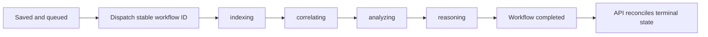

# Temporal workflows and execution lifecycle

[Architecture handbook](../architecture.md) · [Next: LangGraph and patterns](langgraph-and-patterns.md)

Temporal is the durable outer orchestrator. Workflow code chooses activity order;
activities perform filesystem, database, network, and model work. The dashboard
persists its business state in SQLite, while Temporal maintains separate execution
history in its PostgreSQL-backed service. Neither store replaces the other.

## Dashboard submission and dispatch

`POST /api/incidents` persists a queued incident before any Temporal start. The record
captures inputs, repository identity/snapshot when applicable, an immutable effective
settings revision, isolated index/artifact paths, and a stable observability identity.
Uploaded error occurrences are captured independently of diagnosis completion.

The API's reconciler dispatches pending work using `incident-<incident_id>` and
`REJECT_DUPLICATE`. If Temporal accepts a start but the API loses the acknowledgement,
a subsequent start recognizes the same workflow. A Temporal outage leaves submissions
saved and queued. Reconciliation also inspects execution/progress and updates terminal
status; Temporal's close timestamp supplies final timing.

The dashboard workflow receives `{"dashboard": {"incident_id": "..."}}`; each stage
activity receives the incident ID and stage name. Credentials and expanded evidence are
resolved from the shared control store rather than passed in dashboard workflow
payloads. Trace context travels separately as identifiers in workflow headers.

## Four durable stages

All four dashboard stages use `dashboard_stage_activity`. At entry it reads the
incident and its captured settings, records stage/attempt timing, and resolves the
trusted source. On success it persists stage evidence and returns a timing event.
CPU-bound indexing, correlation, and source analysis run off the async event loop.

| Stage | Inputs and functionality | Persisted outputs |
| --- | --- | --- |
| `indexing` | Validate worker access and Compose metadata; resolve deployed source when required; build service map and source index, or copy a compatible prepared snapshot into the run's isolated database. | `index_summary`, source-resolution metadata, stage timing; repository summary for applicable local profiles |
| `correlating` | Parse logs, associate events, choose the primary group, score repository records, identify enclosing symbols, and read candidate snippets. | `parsed_log` with incident context, ranked `candidates`; original logs remain captured separately |
| `analyzing` | Deep-analyze the top configured source candidates; prepare/reuse GitNexus and retrieve bounded call evidence. Graph preparation progress is published while waiting. | `deep_analysis`, `graph_context`, `graph_preparation`, stage timing |
| `reasoning` | Collect available baseline runtime evidence; exclude snapshots belonging to another primary log group; build trusted runtime context; select and run a diagnosis graph; validate and convert the result. | Investigation progress, evidence, diagnostics, reasoning/guardrail summaries, saved report, `report.json` and `report.md` artifacts |

Source-unavailable runtime-enabled incidents preserve parsed primary-group context,
skip source-dependent work, and can continue to runtime-only reasoning. Other source
preparation failures fail explicitly. Version-linked source is checked before use;
the system does not silently analyze a newer commit.

Report creation is part of `reasoning`, not a fifth Temporal stage. Manual checks and
mitigations happen after analysis and are not workflow activities.

## Timeouts, retries, progress, and cancellation

| Execution boundary | Checked-in behavior |
| --- | --- |
| Dashboard diagnosis workflow | One-hour execution timeout at dispatch |
| Each dashboard stage | Ten-minute start-to-close timeout; maximum three activity attempts |
| Analyzing and reasoning heartbeats | Twenty-second heartbeat timeout for current patched histories; helper pulses every five seconds |
| Repository validation | Twenty-second activity timeout; thirty-second workflow execution timeout; caller wait bounded to thirty-two seconds |
| Repository sync | Thirty-minute activity timeout, twenty-second heartbeat timeout, maximum three attempts; one-hour workflow execution timeout |

`get_progress` exposes current workflow stage and completed activity timing events.
The control store also records in-flight progress and evidence, so the UI can retain
information when the progress query is unavailable. Workflow execution timings and
the application incident-event timeline are separate concepts.

Canceling an undispatched incident marks it canceled locally. Canceling a dispatched
incident requests Temporal cancellation, which needs a worker to acknowledge it.
Pending runtime collection work is canceled as part of incident cancellation. Model
and retrieval waits propagate cancellation; completed evidence and investigation
reservations remain durable.

An activity retry is not a new investigation. It reuses the same execution ID, source
snapshot, index path, graph checkpoints, request journal, counters, and original
deadline. Downtime counts against the investigation deadline. External requests can
repeat if the external system completed them before the local result was committed;
the design does not promise exactly-once external execution.

## Execution entry points differ

| Entry point | Execution model | Persistence and capability differences |
| --- | --- | --- |
| Dashboard `/api/incidents` | Durable Temporal stages; immediate accepted response | Saved incident history, reconciled status, progress, artifacts, Issues linkage, and manual outcome history; collector-linked runs can include runtime tools |
| Synchronous `/diagnose` | Directly awaits the four activity functions inside the HTTP request | Uses captured effective settings and an isolated execution index; does not submit the dashboard workflow or gain its dispatch/reconciliation guarantees |
| CLI `diagnose` | Builds index, correlates, analyzes, retrieves graph context, and runs the reasoning service directly | Optional requested JSON/Markdown output; no connected dashboard manual outcome history |
| Legacy `DiagnoseIncidentWorkflow` input | Four separately named Temporal activities | First activity captures settings outside history for the execution; parsed-log snapshots can be offloaded; report returned through workflow result |

All supported diagnosis entry points call the same reasoning selector and can use
iterative investigation when trusted runtime context and optional dependencies are
available. The current CLI and synchronous API do not supply the dashboard collector's
runtime client.

The legacy Temporal activities are `build_service_map_and_index_activity`,
`correlate_logs_activity`, `deep_analysis_activity`, and `diagnosis_graph_activity`.
Their start-to-close timeouts are respectively ten, five, ten (current managed-graph
history), and ten minutes. Unlike dashboard stages, this branch does not explicitly
set a three-attempt retry policy. Expanded parsed logs are stored as content-addressed
`incident-context-*` records in the control store and referenced by
`incident_context_ref`; hydration verifies their digest. This offloading does not
mean all legacy workflow inputs or results contain only IDs.

## Supporting workflows and replay compatibility

`ValidateRepositoryWorkflow` checks repository/Compose access on the worker, where
analysis will actually execute. API-side LLM/storage connection checks establish
reachability from the API process only.

`SyncRepositoryWorkflow` performs a manually requested GitHub sync: validate branch,
fetch objects, prepare a commit-specific checkout, index it, optionally prepare its
graph, and publish a usable snapshot. Repeated requests share an active sync; an
unchanged valid revision reuses prepared data. A failed preparation preserves the
previous usable snapshot. There is no scheduled GitHub polling or webhook sync.

`workflow.patched("bounded-investigation-v1")` and
`workflow.patched("managed-code-graph-v1")` preserve replay compatibility when adding
execution context, deterministic workflow UUID generation, longer graph timeouts,
and heartbeat options. Historical executions can therefore have different activity
arguments/timeouts. Keep these branches when changing workflow definitions; new
features must not rewrite old histories.

## Source and verification map

- [Workflow definitions](../../src/incident_copilot/workflows/temporal_workflows.py): stage order, supporting workflows, patches, activity options.
- [Dashboard gateway/service](../../src/incident_copilot/dashboard/service.py): submissions, stable starts, cancellation, reconciliation.
- [Dashboard activities](../../src/incident_copilot/dashboard/activities.py) and [legacy activities](../../src/incident_copilot/workflows/temporal_activities.py): actual stage work and report persistence.
- [Heartbeat helper](../../src/incident_copilot/workflows/activity_heartbeat.py), [log snapshots](../../src/incident_copilot/workflows/log_context.py), and [repository sync](../../src/incident_copilot/dashboard/repository_sync.py).
- [Temporal integration tests](../../tests/test_temporal_integration.py), [dashboard tests](../../tests/test_dashboard.py), [entry-point tests](../../tests/test_agentic_entrypoints.py), and [recovery tests](../../tests/unit/test_investigation_recovery.py).

Operational references: [repository sources](../repositories.md),
[deployed versions](../deployed-versions.md), [incident timelines](../incident-timeline.md).
